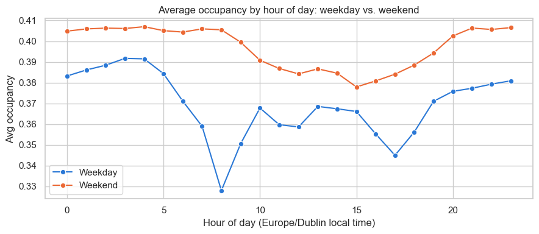

# Dublin Bikes — Station Usage Analysis

A small end-to-end data science project: collect real-time Dublin Bikes station
data from the public GBFS API, clean it, explore usage patterns in a notebook,
and serve the results in an interactive Streamlit dashboard.

**[▶ Try the live dashboard](https://dublin-bikes-analysis-2afr8kyrdmu5wmmxbyawg6.streamlit.app/)**


*Average occupancy across all 114 stations by hour. On weekdays, stations empty out at the morning and evening commute peaks, while weekends stay higher and smoother all day.*

It's intentionally built as a **pipeline of small, separate pieces** rather
than one big script — that's the main thing worth learning from it. Each
stage reads a file the previous stage wrote and doesn't know or care how
that file was produced:

```
scripts/collect_data.py  -->  data/raw/*.csv           (raw snapshots, one row per station per poll)
scripts/clean_data.py    -->  data/processed/*.csv     (one tidy, analysis-ready table)
analysis/*.ipynb         <--  reads data/processed/    (exploration, plots, questions)
dashboard/app.py         <--  reads data/processed/    (interactive version of the same questions)
```

## The data source

This project uses the **GBFS** (General Bikeshare Feed Specification) feed
published for Dublin Bikes by JCDecaux / Smart Dublin — the same open data
that powers things like the TFI Journey Planner:

- Discovery: https://api.cyclocity.fr/contracts/dublin/gbfs/gbfs.json
- Station info (static): https://api.cyclocity.fr/contracts/dublin/gbfs/v2/station_information.json
- Station status (live, refreshes ~every minute): https://api.cyclocity.fr/contracts/dublin/gbfs/v2/station_status.json

**No API key or signup is required** — it's a public JSON feed. That's
unusual (JCDecaux's older "Vélib'-style" API needs a key); GBFS is a
standardized, open format increasingly used by bike-share systems worldwide
specifically so apps like Google Maps and journey planners can integrate
without friction.

The catch: the API only ever gives you the *current* moment. There is no
"give me last week's data" endpoint. This is exactly why `collect_data.py`
exists as a standalone, schedulable script — you have to be the one
snapshotting the present in order to have a past to analyze.

## Project structure

```
dublin-bikes-analysis/
├── scripts/
│   ├── collect_data.py    # polls the API, appends snapshots to data/raw/
│   └── clean_data.py      # merges + cleans data/raw/ -> data/processed/
├── analysis/
│   └── exploratory_analysis.ipynb   # EDA: busiest stations, time patterns, etc.
├── dashboard/
│   └── app.py              # Streamlit dashboard (interactive version of the EDA)
├── data/
│   ├── raw/                # untouched API snapshots (gitignored — you generate these)
│   ├── processed/          # cleaned table used by the notebook & dashboard (gitignored)
│   └── sample/              # a small real sample so the dashboard has something to
│                             # show immediately, without waiting for your own collection
├── requirements.txt
└── .gitignore
```

`data/raw/` and `data/processed/` are gitignored on purpose: this is
*collected*, ever-growing data, not source code, and everyone who clones
this repo can (and should) collect their own. `data/sample/` is the one
exception — a few minutes of real data captured while building this
project, committed so you can see the dashboard populated on the very
first run.

## Setup

```bash
python -m venv .venv
source .venv/bin/activate        # on Windows: .venv\Scripts\activate
pip install -r requirements.txt
```

## Usage

**1. Collect some data.** A single run grabs one snapshot (useful for
testing); `--loop` keeps polling so you build up real history over time —
this is the step that actually needs to run continuously to be useful:

```bash
# one snapshot, then exit
python scripts/collect_data.py

# poll every 5 minutes, forever (Ctrl+C to stop)
python scripts/collect_data.py --loop --interval 300

# poll every 5 minutes for 3 days, then stop on its own
python scripts/collect_data.py --loop --interval 300 --duration 4320
```

For real usage patterns (commuter rush hours, weekday vs. weekend), let
this run for at least a few days. On Linux/macOS, a cron entry works well;
on Windows, use Task Scheduler (see below). A quick test run of a few
minutes is enough to confirm the pipeline works, but won't show you much
of a "pattern" yet.

### Automating collection on Windows (Task Scheduler)

Rather than `--loop`, on Windows it's more reliable to let Task Scheduler
call `collect_data.py` once every few minutes — that way a single crashed
run doesn't kill collection for the rest of the week, and it keeps running
even across reboots/logins.

`scripts/run_collector_task.ps1` is a small wrapper that does the actual
work: it calls `collect_data.py` and appends its output to
`data/raw/collector.log`, so you have somewhere to look if a scheduled run
ever goes quiet. (It shells out to `cmd.exe` for that redirection
specifically because PowerShell's own `*>>` redirection re-encodes an
external program's output as UTF-16 and garbles it — worth remembering if
you ever build a similar wrapper.)

Task Scheduler itself is pointed at `scripts/run_collector_task.vbs`, not
the `.ps1` directly. That extra layer exists purely to stop a console
window from flashing on screen every 5 minutes: `powershell.exe -WindowStyle
Hidden` still briefly flashes a window on some Windows builds, but
launching it through `WScript.Shell.Run(..., 0, False)` from a `.vbs` is
the reliable way to get a genuinely invisible run every time.

To set it up (adjust the interval as needed):

```powershell
$vbsPath = "C:\path\to\dublin-bikes-analysis\scripts\run_collector_task.vbs"
schtasks /create /tn "DublinBikesCollector" `
  /tr "wscript.exe //B `"$vbsPath`"" `
  /sc MINUTE /mo 5 /f
```

Useful commands once it's created:

```powershell
schtasks /query /tn "DublinBikesCollector" /v /fo LIST   # check status / last result
schtasks /run /tn "DublinBikesCollector"                  # trigger a run right now
schtasks /delete /tn "DublinBikesCollector" /f            # stop and remove it
```

By default the task only runs while you're logged in (no stored
credentials needed). If you want it to run even when logged out, recreate
it with `/ru` and `/rp` (username/password) plus `/it` — see
`schtasks /create /?`.

**2. Clean it** into one analysis-ready table:

```bash
python scripts/clean_data.py
```

**3. Explore it** in the notebook:

```bash
jupyter notebook analysis/exploratory_analysis.ipynb
```

**4. Look at the dashboard:**

```bash
streamlit run dashboard/app.py
```

If you haven't collected any data of your own yet, copy the bundled sample
into place first so the dashboard has something to show:

```bash
# macOS/Linux
cp data/sample/station_status_clean_sample.csv data/processed/station_status_clean.csv
# Windows (PowerShell)
Copy-Item data\sample\station_status_clean_sample.csv data\processed\station_status_clean.csv
```

## What the dashboard shows

- A live map of every station, colored by how full it currently is.
- The busiest stations at each end: stations that run mostly *empty*
  (high demand for bikes) and stations that run mostly *full* (popular
  drop-off points) — both are useful for planning manual rebalancing.
- Network-wide occupancy over time, plus per-station comparisons.
- An hour-of-day × day-of-week heatmap, to spot commuter rush-hour patterns
  once enough history has been collected.

## Findings so far (Tue Aug 4 – Thu Aug 13, 2026)

139,080 snapshots across 114 stations (1,220 distinct snapshot times).
The headline change from earlier runs: the collector finally caught a
weekday morning through early afternoon — **Tue Aug 11 has full 24-hour
coverage, and Wed Aug 12 is unbroken from midnight through 2pm local** —
and for the first time the network-wide hour-of-day view actually shows a
commuter rush-hour signature instead of a blank stretch where one should be.

(One correctness fix along the way: `clean_data.py`'s `hour`/`date`/
`day_of_week` columns were previously derived from the raw UTC timestamp
directly. Dublin is on BST — UTC+1 — for the whole of this collection
window, so that silently mislabeled every hour by one. It now converts to
`Europe/Dublin` local time first; all hours below are local.)

- **The weekday morning rush is now visible.** Averaged across weekdays,
  network occupancy is highest overnight (~40% around 4am), falls sharply
  through the morning commute to a low of **32.8% at 8am**, partially
  recovers by mid-morning, then dips a second time to **34.5% around
  5pm** — the evening commute — before climbing back toward 40% overnight.
  That two-trough shape (bikes leave docks at both rush hours, net fewer
  sitting in a dock at that instant) is exactly the commuter signature the
  project set out to find, and it wasn't there in earlier runs because no
  weekday had ever had unbroken 7am–2pm coverage before.
- **Weekends are flatter, as expected.** The weekend hour-of-day curve
  swings only from about 38% to 41% across the whole day — roughly a
  third the range of the weekday curve — with one shallow, broad dip
  around midday/early afternoon rather than two sharp commute troughs.
  That's a leisure-usage signature, not a commute one, and it hasn't
  changed from earlier runs: Saturday and Sunday both have full 24-hour
  coverage (Aug 8 and Aug 9), so this part of the picture was already
  solid.
- **Caveat on weekday sample size.** "Weekday" above is 8 calendar dates,
  but only two of them (Tue Aug 11, Wed Aug 12) have substantial
  coverage — the other six (Aug 4–7, Aug 10, Aug 13) have between 4 and 69
  snapshots each, a leftover from the collection gaps described below. In
  practice the weekday curve is mostly Aug 11 and Aug 12, not an average
  over a full week of weekdays. Worth re-running this notebook again once
  a few more full weekdays have accumulated to confirm the pattern holds.
- **Station-level findings remain stable.** Grangegorman Lower (Central)
  (2.5% avg occupancy), Eccles Street East (4.6%), and Fitzwilliam Square
  East (4.7%) are the clearest demand hotspots; Smithfield North (84%) and
  Heuston Bridge North/South (78–82%) remain the clearest drop-off points.
  Capacity vs. occupancy correlation is -0.34 — still weak-to-moderate,
  same conclusion as before: station location plausibly matters more than
  size.

**On the collection gaps themselves:** the multi-hour dropouts that
previously blanked out every weekday's 7am–2pm window (and left Aug 10
almost entirely uncollected) were traced to Windows power states — the
laptop sleeping or losing power outside logged-in hours, which silently
stops the Task Scheduler task (it doesn't wake the machine and only runs
while logged in; see "Automating collection on Windows" above). `collector.log`
shows the signature clearly: runs stop cleanly with no error, then resume
hours later as if nothing happened. That's now resolved, which is what
let Aug 11 and Aug 12 come through gap-free.

## Notes on design choices

- **Occupancy ratio** (`bikes available ÷ dock capacity`) is used instead of
  raw bike counts throughout, because comparing raw counts across stations
  of very different sizes is misleading — 5 free bikes means something
  different at a 10-dock station than at a 40-dock station.
- Charts use a single blue hue, light→dark, for anything that's a
  *magnitude* (occupancy, demand ranking), and a small fixed-order set of
  distinct hues only where something is a genuine *category* (comparing a
  handful of named stations on one chart) — so color always tells you
  whether you're looking at "how much" or "which one."
- One CSV per UTC day in `data/raw/` (rather than one giant ever-growing
  file) keeps individual files small enough to open and skim directly.

## Ideas for extending this

- Join in a weather API and check whether rain suppresses ridership.
- Fit a simple model to predict next-hour occupancy for a given station.
- Add a "stations at risk of going empty/full in the next hour" alert view.
